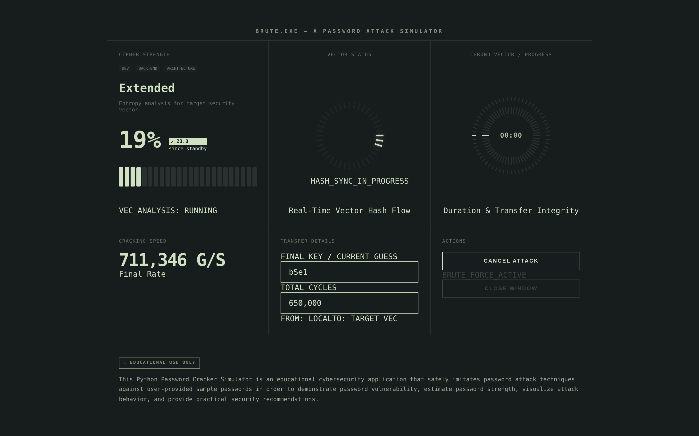

# BRUTE.EXE - Educational Password Cracking Simulator

> An educational hash-cracking dashboard built to demonstrate how MD5, SHA-1, SHA-256, and bcrypt fare against brute-force, dictionary, and mask-based attacks - and why bcrypt wins.

[](https://github.com/Johndenisnyagah/password_cracker_simulator/actions/workflows/ci.yml)


[](LICENSE)

> **Educational use only.** This tool only ever cracks hashes that you paste into it. It never sends data anywhere, never targets remote systems, and is not a real attacker\'s tool. See [Security & ethics](#security--ethics).

---

## Demo



_A brute-force run in progress — entropy analysis, live cracking speed, the current guess, and the attempt count all stream from the backend over a WebSocket. The [Setup](#setup) section runs the full dashboard locally in two commands._

**Try it live:** not currently hosted. The backend deploys from the included `render.yaml` (free tier) paired with Vercel/Netlify for the frontend. See [Setup → Render](#render-backend).

---

## What this project demonstrates

This is a portfolio project intended to show:

- **Realistic threat modelling** - the three industry-standard offline attack strategies (brute force, dictionary, mask) against six hash algorithms, from fast digests (MD5/SHA) to slow KDFs (bcrypt, Argon2id, PBKDF2).
- **Async Python** - FastAPI + WebSockets streaming progress events from an async generator-based cracker engine.
- **Defensive engineering** - Pydantic request validation, an Origin allowlist on the WebSocket handshake (see below), asyncio.Semaphore for connection limits, search-space safety caps, structured error responses.
- **Why bcrypt matters** - the same dictionary attack that cracks a SHA-256 hash in microseconds takes orders of magnitude longer against bcrypt; a brute force against bcrypt is refused outright with a years-to-finish estimate.

---

## Tech stack

| Layer | Stack |
|---|---|
| Backend | Python 3.12, FastAPI, Pydantic v2, Uvicorn, asyncio |
| Crypto | hashlib (md5/sha1/sha256, pbkdf2), bcrypt, argon2-cffi |
| Frontend | React 19, TypeScript 5, Vite 7 |
| Tests | pytest, pytest-asyncio, websockets (client) |
| Deploy | Docker, Render (backend), Vercel/Netlify (frontend) |

---

## Attack modes

The backend exposes one WebSocket endpoint - `ws://<host>/ws/simulate` - that accepts an `AttackRequest` payload and streams `starting` -> `running` -> `complete` / `exhausted` / `error` updates.

### 1. Brute force

Iterates every candidate over a charset up to `max_length`. Search space is checked against a hard safety cap (`26^6 = 308,915,776`) before iteration starts.

```json
{
  "hash": "187ef4436122d1cc2f40dc2b92f0eba0",
  "algorithm": "md5",
  "attack_mode": "brute_force",
  "charset": "alphanumeric",
  "max_length": 3
}
```

Supported charsets: `lower`, `upper`, `digits`, `alphanumeric`, `all`.

### 2. Dictionary

Tries entries from the bundled `wordlist.txt` (~166 common passwords). Wins almost instantly against the kind of passwords found in real breach corpora.

```json
{
  "hash": "5e884898da28047151d0e56f8dc6292773603d0d6aabbdd62a11ef721d1542d8",
  "algorithm": "sha256",
  "attack_mode": "dictionary"
}
```

### 3. Mask (Hashcat-style)

Constrains the search to a known pattern. Useful for passwords with predictable structure (e.g. `username + ?d?d`).

Tokens: `?l` (lower), `?u` (upper), `?d` (digits), `?s` (special), `?a` (all). Literal characters are kept as-is.

```json
{
  "hash": "5e75a4e07ac1d2956ae9211e0b1a5bdf2c79c8c8",
  "algorithm": "sha1",
  "attack_mode": "mask",
  "mask": "?l?l?d?d"
}
```

---

## The bcrypt moment

bcrypt is slow on purpose, and how slow depends on the cost factor stored in the hash itself (`$2b$12$...` is cost 12; each +1 doubles the work). The simulator reads that cost and times one real check against your hash before it starts, so its estimates are measured rather than assumed.

Measured with `python scripts/benchmark.py` ([full results](docs/benchmark-results.md)):

| Algorithm | Measured speed | Time to try every 6-char lowercase password |
|---|---|---|
| MD5 / SHA-1 / SHA-256 | ~1M guesses/s | ~5 minutes |
| bcrypt cost 10 | 73 ms/check | ~261 days |
| bcrypt cost 12 | 266 ms/check | ~2.6 years |

The fast-hash rows are this pure-Python engine on one core; a GPU cracker such as Hashcat is far faster, so treat them as a floor for an attacker.

- **Dictionary attack against bcrypt:** finds `qwerty` on the fourth guess (about 1 s at cost 12), because the password is in the wordlist. bcrypt does **not** protect a weak password.
- **Brute force against bcrypt:** the simulator refuses to spin for years. It warns, for example, *"Brute-forcing this space would take roughly 1.5 days (cost 12, 266 ms/check measured on this server)"* for four lowercase characters, and stops after 500 attempts or 30 seconds, whichever comes first. The same cap applies to dictionary and mask runs against bcrypt.
- **The server stays responsive.** Each bcrypt check runs in a worker thread, so a slow job never blocks other connections. Before this fix, one cost-12 bcrypt brute force froze the event loop: `/health` took 134 s to answer and the client was disconnected. `test_health_stays_responsive_during_bcrypt_attack` guards against a regression.
This is the educational payoff: bcrypt buys you time against brute force, but a weak password is still a weak password. The same holds for Argon2id and PBKDF2 — both are supported here, and a dictionary attack still finds `qwerty` under either.

---

## Storage audit (the defensive side)

Cracking shows how storage fails; the audit shows what good storage looks like. `POST /audit` takes a pasted hash and grades how it was produced against the [OWASP Password Storage Cheat Sheet](https://cheatsheetseries.owasp.org/cheatsheets/Password_Storage_Cheat_Sheet.html), without ever needing the plaintext. It identifies the algorithm from the hash's own structure and checks its parameters.

```bash
curl -s localhost:8000/audit -H 'content-type: application/json' \
  -d '{"hash":"5e884898da28047151d0e56f8dc6292773603d0d6aabbdd62a11ef721d1542d8"}'
# { "algorithm": "sha256", "verdict": "unsuitable",
#   "recommendation": "SHA-256 is a fast general-purpose hash, not a password KDF..." }
```

Verdicts: `strong` (a modern KDF at or above OWASP minimums), `weak` (a password KDF below them, e.g. bcrypt under cost 10 or Argon2id under 19 MiB), `unsuitable` (a bare MD5/SHA digest), `unknown` (unrecognised format). OWASP ranks **Argon2id** first, then scrypt, with **bcrypt** a legacy choice (work factor ≥ 10) and PBKDF2-HMAC-SHA256 at ≥ 600,000 iterations where FIPS compliance is needed.

---

## Setup

### Prerequisites

- Python 3.12+
- Node.js 18+

### Backend

```bash
pip install -r requirements.txt
python main.py
# or: uvicorn main:app --host 0.0.0.0 --port 8000
```

The backend listens on `:8000` by default. Visit `http://localhost:8000/health` to confirm it is up.

### Frontend

```bash
npm install
npm run dev
```

Vite serves the dashboard at `http://localhost:5173`. The frontend connects to the backend at `VITE_BACKEND_WS_URL` (defaults to `ws://localhost:8000`) - set it in `.env.local` for non-local deploys.

### Docker

```bash
docker build -t brute-exe .
docker run -p 8000:8000 -e CORS_ORIGINS=http://localhost:5173 brute-exe
```

### Render (backend)

The included `render.yaml` deploys the FastAPI backend as a free-tier web service. Pair it with Vercel or Netlify for the frontend.

---

## Configuration

| Env var | Default | Purpose |
|---|---|---|
| `CORS_ORIGINS` | `http://localhost:5173,http://127.0.0.1:5173` | Comma-separated allowlist of origins, used for HTTP CORS **and** for the WebSocket Origin check. Set this to your deployed frontend URL in production. |
| `PORT` | `8000` | Render injects this automatically. |

---

## Testing

```bash
pytest -v
```

The suite covers:

- **`test_simulator.py`** (26 tests) - hash verification across md5/sha1/sha256/bcrypt, brute-force happy + exhausted + oversize cases, dictionary happy + exhausted + bundled-wordlist cases, mask parser (4 cases) and mask attack happy + oversize cases, and three bcrypt checks (the event loop is never stalled; mask runs are capped; the time budget stops a run).
- **`test_security.py`** (6 tests, end-to-end via a live uvicorn server) - invalid payload rejection, invalid JSON, unsupported algorithm, search-space cap, end-to-end happy path, and `/health` answering in under 0.5 s while a bcrypt job runs.

**Current status:** 32/32 passing in under five seconds.

---

## Architecture

```
+----------------+   WebSocket    +---------------------+
|  React UI      | <------------> |  FastAPI endpoint   |
|  (Vite/TS)     |  JSON stream   |  /ws/simulate       |
+----------------+                +----------+----------+
                                             |
                                             v
                                  +----------+----------+
                                  |  HashCracker        |
                                  |  - brute_force()    |
                                  |  - dictionary()     |
                                  |  - mask()           |
                                  +----------+----------+
                                             |
                                             v
                                  +----------+----------+
                                  |  hashlib / bcrypt   |
                                  +---------------------+
```

The cracker is an async generator. Each iteration yields a JSON-serialisable progress dict, the endpoint forwards it over the WebSocket, and the React dashboard merges it into its `stats` state.

---

## Security & ethics

This is a teaching tool. It hashes guesses locally and compares them to a hash you paste into the UI. It does not - and cannot - target remote systems.

**Do not use this (or any cracking tool) against systems you do not own or have written permission to test.** Unauthorised computer access is illegal in most jurisdictions (US: CFAA, UK: Computer Misuse Act, EU: NIS 2 / national law).

### A flaw I found in my own defences

The first version listed "env-driven CORS allowlist" as a security control. It did not protect the WebSocket at all: Starlette's `CORSMiddleware` only applies to HTTP requests, and browsers do not enforce CORS on WebSocket handshakes. A test connection with `Origin: https://evil.example` was accepted and ran a full attack. That is cross-site WebSocket hijacking ([CWE-1385](https://cwe.mitre.org/data/definitions/1385.html)): any web page could have driven the server from a visitor's browser.

The endpoint now checks the `Origin` header against `CORS_ORIGINS` before accepting the handshake and refuses anything else with HTTP 403. Requests without an Origin header (scripts, curl, the test suite) are allowed, because only browsers send one and a non-browser client could forge it anyway. `test_foreign_origin_websocket_is_rejected` guards the fix.

If you are interested in this space:
- Try the [Hack The Box Academy](https://academy.hackthebox.com/) password-cracking modules.
- Read [OWASP\'s password storage cheat sheet](https://cheatsheetseries.owasp.org/cheatsheets/Password_Storage_Cheat_Sheet.html).
- For real research on offline cracking, use [Hashcat](https://hashcat.net/) or [John the Ripper](https://www.openwall.com/john/) - both far faster than anything this educational simulator does.

---

## Roadmap

Done since the first version:

- [x] CI pipeline (GitHub Actions: ruff, pytest, Docker build, frontend build).
- [x] Hardened Dockerfile (non-root user, HEALTHCHECK).
- [x] Logging via stdlib `logging` instead of `print()`.
- [x] bcrypt checks moved off the event loop; measured cracking benchmarks.
- [x] WebSocket `Origin` allowlist.

Still on my list:

- [x] Argon2id and PBKDF2 support, plus a `POST /audit` "does this hash meet OWASP?" verdict.
- [ ] scrypt support in the cracker (recognised by the audit already).
- [ ] Optional larger wordlists (rockyou-style) loaded from a path instead of bundled in the repo.
- [ ] `mypy` once the handlers and WebSocket payloads are fully annotated.
- [ ] Multi-stage Docker build to drop build-time layers.

---

## How this was built

I wrote the first version of BRUTE.EXE myself. I then used Claude (Anthropic) as a pair-programmer to review it against how this project would read to a security employer, and to help implement the fixes: moving bcrypt off the event loop, the WebSocket `Origin` check, the measured benchmarks, and this tidy-up. I reviewed and approved each change, and the test suite and CI gate everything that landed. The commits carry a `Co-Authored-By` trailer where Claude contributed.
